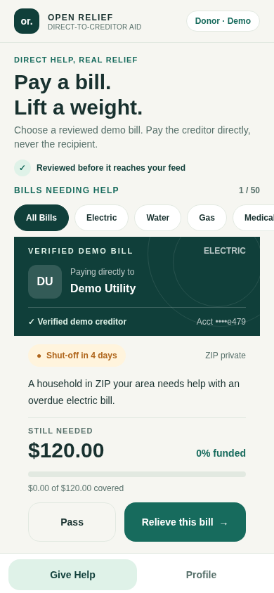
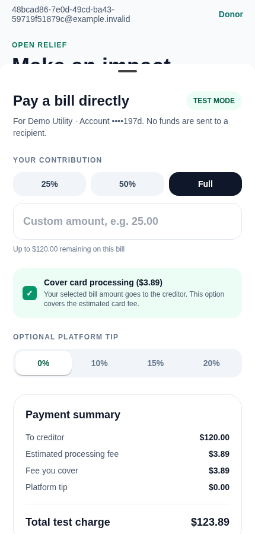

# open-relief

A local, zero-cash **demo** for direct-to-creditor mutual aid. Recipients submit overdue bills, the mock OCR worker verifies demo billers, and donors simulate a payment that settles against the biller account. Optional Stripe test mode uses test cards and a simulated Method sandbox payment. No live charge, payout, or recipient cash transfer is implemented.

See [PROGRESS.md](PROGRESS.md) for the current implementation, verification results, and remaining approval gates.

## Run locally

Use Node.js 22 or newer, pnpm 11.25, Docker Compose, and Poppler's `pdftoppm` command for admin PDF previews.

```bash
export XDG_DATA_HOME="$PWD/.local/share"
pnpm install --frozen-lockfile --store-dir "$PWD/.pnpm-store"
bash scripts/start-local.sh
```

The startup script creates an ignored `.env.local` with random local credentials if needed, starts PostgreSQL, Redis, and MinIO, applies migrations, seeds seven demo bills across electric, water, gas, medical, and telecom, builds the server packages, and runs the API and OCR worker. It preserves an existing `.env.local`. Stop the foreground script to stop the API and worker; use `docker compose --env-file .env.local down` to stop local services. Data volumes remain until explicitly removed.

The API listens on `http://127.0.0.1:3000`. A successful `GET /health` returns `{"status":"ok"}`. `GET /api/bills/feed` lists the verified demo bills. Create a recipient or donor account in the mobile app to upload bills or simulate donations. Seeded demo users cannot sign in because they have no passwords.

In another terminal, run the Expo app:

```bash
EXPO_NO_TELEMETRY=1 EXPO_OFFLINE=1 pnpm --filter @open-relief/mobile start
```

Set `EXPO_PUBLIC_API_URL` to the API address reachable by your simulator or device. Android emulators usually use `http://10.0.2.2:3000`; iOS simulators can use `http://127.0.0.1:3000`. A physical device needs the host machine's LAN address and an API bind address that permits it.

## Browser preview

With the API running, use `pnpm preview:web` in a second terminal. The command exports the actual Expo UI for web and serves it on loopback port 8081 with a same-origin proxy to the local API. Create a donor account to inspect the seeded bills and try a mock payment. This preview stores its demo session in browser local storage; Stripe PaymentSheet remains native-only, and recipient document upload should be tested in the mobile app.

The captured screens below come from the actual app running against the seeded local API. The visual system uses a warm canvas, pine and mint surfaces, readable amount hierarchy, and explicit demo creditor labels across donor and recipient flows:





More screens: [welcome](docs/previews/auth.png), [medical category](docs/previews/categories-medical.png), [telecom category](docs/previews/categories-telecom.png), [payment breakdown](docs/previews/checkout-summary.png), [confirmation](docs/previews/confirmation.png), and [recipient intake](docs/previews/recipient.png).

## Validate

With the local services running and `.env.local` loaded into the shell:

```bash
set -a
source ./.env.local
set +a
pnpm typecheck
pnpm test
EXPO_NO_TELEMETRY=1 EXPO_OFFLINE=1 pnpm --filter @open-relief/mobile export
EXPO_NO_TELEMETRY=1 EXPO_OFFLINE=1 pnpm --filter @open-relief/mobile exec expo export --platform web
```

The end-to-end test uploads a JPEG through the presigned form, checks EXIF removal, waits for mock OCR, rejects a duplicate, creates a mock donation, verifies the webhook signature and replay handling, and confirms the bill is settled. Adapter tests exercise signed Stripe test webhook fixtures, partial and full settlement, fee splits, and Method sandbox routing without external credentials. Vetting and admin tests check eligibility, role guards, approval, rejection, audit records, and feed visibility. Tests create uniquely identified demo data on each run.

## Stripe test checkout and Method simulation

Mock mode remains the default. To enable Stripe test PaymentIntents, set `STRIPE_SECRET_KEY=sk_test_...` and `STRIPE_WEBHOOK_SECRET=whsec_...` in the API environment. Set `EXPO_PUBLIC_STRIPE_PUBLISHABLE_KEY=pk_test_...` when bundling the mobile app. Only test keys are accepted. Route Stripe test webhooks to `POST /api/webhooks/stripe` using Stripe's test webhook signing secret. A native Expo development build is required for PaymentSheet; Expo Go does not contain the Stripe native module. The local demo completion endpoint accepts mock intents only.

The backend computes the existing fee split before creating a test intent. Webhooks validate Stripe's signature, payment amount, currency, and donation metadata. A successful event sends a deterministic simulated payment to an allowlisted demo creditor, records the Stripe charge and Method style `pmt_...` reference, and updates the bill in one database transaction. `METHOD_PROVIDER=sandbox` enables the same local Method sandbox simulator in mock Stripe mode. It models `https://dev.methodfi.com/v1` but makes no outbound Method API call or funds transfer. The receipt email payload is stored with the transaction; no email is sent.

## Authentication and OCR modes

`POST /api/auth/signup` accepts an email, password of at least 12 characters, phone, and `recipient` or `donor` role. Recipients also provide the legal name on the bill and may self-report an assistance program. `POST /api/auth/signin` returns a signed JWT session token; clients send it as `Authorization: Bearer <token>`. The server stores only a hash of the token's random session ID for revocation and enforces roles and ownership on bill uploads, donations, and receipts. The mobile app stores the token with Expo SecureStore and supports sign out.

The OCR worker defaults to `OCR_PROVIDER=mock`. Set `OCR_PROVIDER=textract` and `AWS_REGION` when AWS credentials are available through the standard SDK credential chain. The Textract adapter calls `AnalyzeDocument` with account number, amount, due date, biller name, and account holder queries; it also reads notice text from detected lines. Its extracted bill remains pending manual review until a creditor routing ID is independently verified; extraction alone never authorizes payment.

## Eligibility and donor experience

Before a bill enters the feed, the vetting service checks for shut-off or past-due language, a $600 UTC calendar-year aid limit, a 60-day cooldown after aid, and at least 80% account-holder name similarity. The yearly limit counts successful creditor payments and remaining balances of active verified bills; `lifetime_aid_cents` retains the historical total. Non-urgent or over-limit submissions are rejected. Cooldown, name mismatch, low OCR confidence, or an unverified merchant require manual review and stay off the feed. Recipient status responses explain rejection or review; donors see only verified or funded bills and a masked creditor account suffix.

The donor app has a spring-driven swipe deck with haptics, category filters for electric, water, gas, medical, and telecom bills, an urgency indicator, a direct-creditor checkout sheet with preset or custom amounts, an unchanged fee split, and a confirmation card. A test PaymentSheet success first shows payment acceptance; the creditor confirmation appears only after the signed webhook records settlement. The app can share the non-deductible payment confirmation.

## Admin review and legal acceptance

Recipients must name the creditor and accept the versioned attestation before the API issues an upload URL. The API records the acceptance time and version on the bill. Donors must accept the versioned gift disclosure before the API creates a payment intent; the transaction stores that acceptance. Checkout, confirmation, and Profile display the sandbox brand and payment-policy notice. The app also displays Terms of Service and Privacy Notice modals. These are sandbox legal drafts and need qualified legal review before public use. The notice describes agent-of-the-payee agreements as a future requirement and does not claim one exists today.

Admin accounts cannot be created through public signup. For a local admin, provide `ADMIN_EMAIL`, `ADMIN_PASSWORD` (at least 12 characters), and `ADMIN_PHONE` through the local shell or secure environment settings, load `.env.local`, then run `pnpm --filter @open-relief/api bootstrap-admin`. The command refuses to run with `NODE_ENV=production` and refuses to elevate an existing email. Sign in with that account through the mobile app. In development builds, Profile can switch between previously authenticated recipient, donor, and admin accounts; switching verifies the stored session with the server and never changes the account's role.

The admin API lists pending reviews with pagination, serves review previews and original documents to authenticated admins, and records approve or reject decisions in the audit log. Approval requires the current recipient attestation, an allowlisted demo creditor, an intact balance, and room under the annual aid limit. Rejection stores the stated reason. The API formats a recipient notification payload but does not send email. The mobile screen previews JPEG and PNG files and the first page of PDF files. PDF reviewers should inspect the original document through the admin document API when it has more than one page.

## Boundaries

- Stripe test mode can present PaymentSheet with test cards, but no real funds move. The Method adapter is a local sandbox simulation and cannot disburse money.
- The mock OCR adapter recognizes only a demo electric biller. Uploads in other categories stay in manual review until a category-matched demo creditor is independently verified; seeded medical and telecom bills demonstrate the donor flow. Textract extraction can produce a bill for manual review, but it cannot approve a live creditor or route money.
- Authentication uses local password accounts and revocable database sessions. Names and assistance programs are self-reported, so the match is a review signal rather than proof of identity. Household linking, email verification, password recovery, abuse throttling, stronger admin enrollment, full document viewing in the mobile app, and delivered decision notifications are still required before public deployment. The API remains bound to loopback.
- Payment confirmations make no tax-deductibility claim. Direct bill payments are not automatically charitable contributions, and the project has no verified 501(c)(3) status. The generated email payload is a payment confirmation, not a charitable tax receipt.
- A future live design needs verified creditor routing, payment-provider coordination, authentication, privacy and fraud controls, and legal review. A Stripe charge followed by a separate disbursement does not alone establish that the platform avoids custody or money-transmission obligations.
